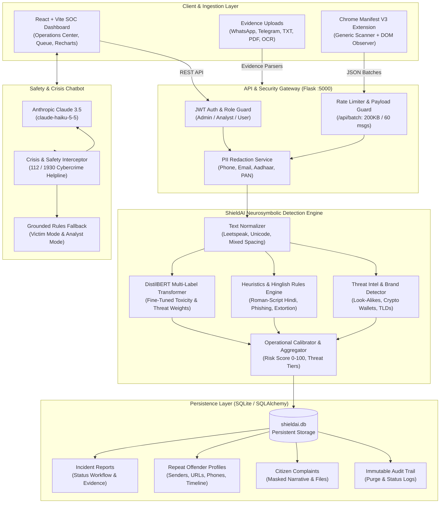

# ShieldAI — Cyber Threat Intelligence & Harassment Detection Platform

> **MCA Final-Year Project: ShieldAI**  
> A production-grade, neurosymbolic cyber safety platform for detecting online harassment, cyberbullying, physical threats, phishing, financial scams, and extortion. Built for digital safety, trust & safety incident triaging, forensic evidence preservation, and real-time browser protection.

---

## ⚡ Quick Start: 3 Steps to Run

### Option A: Local Single-Command Launch (Recommended for Dev)

#### 1. Clone & Set Up Python Environment
```powershell
# Create & activate virtual environment (Windows PowerShell)
python -m venv venv
.\venv\Scripts\Activate.ps1

# Install dependencies
pip install -r backend/requirements.txt
cd frontend && npm install && cd ..
```

#### 2. Seed Realistic Demo Threat Data
```powershell
$env:PYTHONPATH="backend"
.\venv\Scripts\python.exe scripts/seed_demo_data.py
```

#### 3. Launch Platform in One Command
### 1. Automated Setup & Installation (One Command)
- **Windows:** Run `setup.bat`
- **Linux / macOS:** Run `chmod +x setup.sh && ./setup.sh`

The automated setup script:
1. Validates Python (>= 3.10) and Node.js.
2. Creates and activates virtual environment `venv`.
3. Installs all backend dependencies from `backend/requirements.txt` (pinned torch, transformers, rapidocr).
4. Installs frontend npm packages (`npm install`).
5. Initializes and seeds the demo database with 40 incidents, 7 repeat offenders, and 3 complaints.
6. Executes `scripts/doctor.py` to confirm all components are operational.

---

### 2. System Verification (Doctor)
Run the diagnostic doctor anytime to verify dependencies, models, and port availability:
```bash
# Windows
venv\Scripts\python.exe scripts\doctor.py

# Linux / macOS
python scripts/doctor.py
```

---

### 3. Launch ShieldAI Services

- **Option A: One-Click Startup:**
  - **Windows (PowerShell):** `.\start.ps1`
  - **Windows (CMD):** `start.bat`
  - **Linux / macOS:** `chmod +x start.sh && ./start.sh`

- **Option B: Manual Terminal Launch:**
  - **Terminal 1 — Backend (Port 5000):**
    ```bash
    # Windows
    venv\Scripts\python.exe backend\app.py

    # Linux / macOS
    source venv/bin/activate && python backend/app.py
    ```
  - **Terminal 2 — Frontend (Port 5173):**
    ```bash
    cd frontend && npm run dev
    ```

- **Frontend SOC Dashboard:** [http://localhost:5173](http://localhost:5173)
- **Backend API Server:** [http://127.0.0.1:5000](http://127.0.0.1:5000)
- **API Health Check:** [http://127.0.0.1:5000/api/health](http://127.0.0.1:5000/api/health)
- **Default Admin Credentials:**
  - **Username:** `admin`
  - **Password:** `password123` *(development default; configured via `ADMIN_PASSWORD` in `.env`)*

---

## 🏗️ System Architecture

ShieldAI adopts a **Neurosymbolic Multi-Modal Architecture** combining transformer neural embeddings with rule-based heuristics, threat intelligence correlation, and an AI crisis assistant.



### 🎯 Fine-Tuned DistilBERT Multi-Label Classifier & Decision Thresholds

ShieldAI deploys a fine-tuned DistilBERT multi-label sequence classification transformer (`backend/models/shieldai/model.safetensors`) calibrated on toxicity and cyberbullying corpora. Sigmoid outputs are mapped to operational risk scores using the calibrated thresholds configured in `thresholds.json`:

| Category | Calibrated Decision Threshold ($\tau$) | Operational Role & Focus |
| :--- | :--- | :--- |
| **Hate Speech** | `0.8076` | Identity-based hate speech, targeted slurs, discrimination |
| **Cyberbullying / Harassment** | `0.8905` | Severe targeted harassment, sustained derogatory abuse |
| **Threat** | `0.5332` | Physical violence, death threats, bodily harm |
| **Toxicity / Offensive Language** | `0.4210` | Hostile insults, abusive commentary, general toxicity |
| **Profanity** | `0.9966` | Explicit vulgarity and isolated obscene lexicon |
| **Clean** | `0.6906` | Benign, civil, and safe conversational dialogue |

Raw model probabilities $p_i \in [0, 1]$ are mapped to a 0–100 risk score using a piecewise linear calibration function centered at $p_i = \tau_i \implies \text{Score}_i = 50.0$. Plain insults and abuse are capped at 74.0 (band maximum for High), ensuring Critical level ($\ge 75.0$) is strictly reserved for actionable threats, sextortion blackmail, and high-confidence fraud.

### 📊 Held-Out Benchmark Performance (`backend/data/final.csv` — 9,629 rows)

Evaluated strictly once on the held-out test split (10,815 positive annotations):

- **Headline Operational Benchmark (5 Abuse Labels, Excluding Clean):**
  - **DistilBERT Neural Model Alone:** Macro F1 = **0.7449**
  - **Full Hybrid Engine (Model + Rules):** Macro F1 = **0.7387** ($\Delta\text{F1} = -0.0062$)
- **Overall Benchmark (All 6 Labels, Including Clean):**
  - **DistilBERT Neural Model Alone:** Macro F1 = **0.7826**
  - **Full Hybrid Engine (Model + Rules):** Macro F1 = **0.7773** ($\Delta\text{F1} = -0.0053$)

| Evaluation Mode | Hate Speech | Cyberbullying | Threat | Toxicity | Profanity | Clean | **Headline: 5-Abuse Macro** | **6-Label Macro** |
| :--- | :--- | :--- | :--- | :--- | :--- | :--- | :--- | :--- |
| **Model Alone** | 0.8147 | 0.7604 | 0.5405 | 0.7989 | 0.8098 | 0.9710 | **0.7449** | **0.7826** |
| **Hybrid Engine** | 0.8147 | 0.7513 | 0.5195 | 0.7982 | 0.8098 | 0.9703 | **0.7387** | **0.7773** |

*Note on Physical Threat Heuristics:* Deterministic physical-harm rules are not claimed to be universally essential across this benchmark corpus (on `final.csv` they added 0 new true positives and 3 false positives). They are intended as a targeted safety net for severe threats that the English-only neural model may miss outside this dataset (e.g. novel phrasing, Roman-script Hinglish threats like *"jaan se maar dunga"*, and leetspeak like *"k1ll urself"*), and are evaluated separately on dedicated stress tests.

### 🛡️ Fraud & Scam Evaluations

1. **UCI SMS Spam Collection (5,572 messages, 50/50 split with seed 42):**
   - *Tuning Split Analysis (`sms_tune.tsv`):* Manual categorization of 100 false negatives revealed 57% premium-rate subscription marketing, 23% prize/lottery scams, 6% phishing, and 14% other. Celebration triggers ("congratulations") were hardened to require prize/payment context, and domain endings were restricted to full alphanumeric tokens.
   - *Held-Out Final Split (`sms_final.tsv` — 2,786 rows: 2,413 ham, 373 spam):*
     - **Precision:** **100.0%** (36 TP, **0 FP** on 2,413 legitimate ham messages; 0.00% FP rate).
     - **Recall:** **9.65%** (36 TP / 373 spam; 337 FN reflecting 2000s UK carrier marketing ads).
     - **F1-Score:** **17.60%** (prioritizing zero false alarms on innocent civilian correspondence).
     - **Confusion Matrix:** `[[TN=2413, FP=0], [FN=337, TP=36]]`.
   - *Caveat:* The UCI SMS corpus dates from 2000s UK mobile networks and contains substantial commercial ringtone and mobile marketing promotions.

2. **Developer Security Fraud Benchmark (`backend/data/fraud_cases.csv` — 45 cases):**
   - *Caveat:* Written by the engineering team to test known attack vectors (Indian banking KYC, digital arrest, electricity threats, WFH Telegram lures, crypto extortion, look-alike domains); not an independent benchmark.
   - **Accuracy:** **100.0%** (45 of 45 cases passed).
   - **Precision:** **100.0%** (23 TP, **0 FP** — zero legitimate bank OTPs or delivery alerts flagged).
   - **Recall:** **100.0%** (23 TP / 23 true fraud cases).
   - **F1-Score:** **1.0000 (100.0%)**.


---

## 🧩 Chrome Browser Extension (Manifest V3)

The ShieldAI browser extension provides unobtrusive, real-time scanning of web content to protect users from harassment, cyberbullying, phishing, and extortion while browsing social networks, forums, and webmail.

### 1. Installation Instructions
1. Open Google Chrome and navigate to `chrome://extensions/`.
2. In the top right corner, toggle **Developer mode** to **ON**.
3. Click the **Load unpacked** button in the top left.
4. Select the `extension/` directory from this project repository (`online-harassment-detection/extension`).
5. **Critical for Local Testing:** Click **Details** on the installed ShieldAI card, scroll down, and switch **"Allow access to file URLs"** to **ON**.

### 2. Testing the Extension
We provide two ready-to-test verification pages:
- **Test Page 1 (Simulated Social Feed):** Open [`extension/test.html`](file:///c:/Users/jayanth/Downloads/online-harassment-detection/extension/test.html) or [http://localhost:5173/test.html](http://localhost:5173/test.html). Contains simulated social media posts, comments, direct messages, and phishing banners.
- **Test Page 2 (Generic Markup Scanner):** Open [`extension/test_generic.html`](file:///c:/Users/jayanth/Downloads/online-harassment-detection/extension/test_generic.html) or [http://localhost:5173/test_generic.html](http://localhost:5173/test_generic.html). Contains standard `<p>` paragraphs with no special CSS classes:
  - Clean conversational paragraph
  - Urgent banking phishing alert
  - Abusive cyberbullying insult
  - Physical violence threat

### 3. Core Capabilities
- **Generic Fallback Scanner:** Automatically parses text blocks in `<p>`, `<li>`, `<blockquote>`, `<div>`, and `<span>` elements (between 15 and 600 characters without block children) across any website.
- **Element Safety Exclusions:** Never scans `<input>`, `<textarea>`, `<pre>`, `<code>`, content-editable fields, password forms, or ShieldAI's own UI badges (`.shieldai-badge`).
- **Safe Badge Suppression (Default Off):** To minimize visual clutter, clean/benign messages display no badge by default. Users can enable "Show Safe Badges" anytime via the extension popup.
- **Per-Site Opt-Out:** Instant toggle in the popup ("Scan this website") allows users to disable scanning on specific domains (e.g. internal intranets).
- **SPA & Infinite Scroll Support:** Watches DOM mutations (`MutationObserver`) and hooks SPA history events (`pushState`, `replaceState`, `popstate`), ensuring newly scrolled comments are scanned without re-scanning existing elements.
- **Throttled Batch Engine:** Batches requests in chunks of up to 30 elements with a 350 ms throttle to protect network bandwidth and backend compute.

### 4. Extension Troubleshooting

| Issue / Symptom | Root Cause | Resolution |
| :--- | :--- | :--- |
| **Popup shows "Backend Offline" (Red Indicator)** | Backend Flask server is not running on port 5000. | Run `.\start.ps1` or `start.bat`. Verify [http://127.0.0.1:5000/api/health](http://127.0.0.1:5000/api/health) returns HTTP 200. |
| **Badges not appearing on local HTML files** | Chrome blocks extensions from accessing local `file:///` URLs by default. | Open `chrome://extensions/` $\to$ click **Details** on ShieldAI $\to$ turn **Allow access to file URLs** ON. |
| **Clean messages have no badges** | Safe badge suppression is active by default to prevent visual clutter. | Click the ShieldAI extension icon and check the **"Show Safe Badges"** toggle. |
| **Custom Server URL fails to connect** | Missing browser permission for custom host/port. | In the popup, enter your custom URL (e.g., `http://192.168.1.100:5000`) and click **Save Server**. Approve Chrome's dynamic origin permission prompt. |
| **CORS Preflight Error in DevTools console** | Origin was blocked by restrictive server policy. | ShieldAI backend includes full CORS headers (`origins="*"`) and explicitly supports `chrome-extension://*` origins. |

---

## 🔒 Privacy, PII Redaction & Data Retention

ShieldAI is built with privacy-by-design principles adhering to digital data protection standards:

### 1. Automated PII Redaction
All incident preview snippets, repeat offender timeline entries, and citizen complaints are automatically sanitized using regex pattern masking before saving to the database:
- **Phone Numbers (Indian & International):** `+919876543210` $\to$ `[PHONE REDACTED]`
- **Email Addresses:** `victim@example.com` $\to$ `[EMAIL REDACTED]`
- **Aadhaar Numbers (12-digit Indian National ID):** `9999 8888 7777` $\to$ `[AADHAAR REDACTED]`
- **PAN Card Numbers (10-character Tax ID):** `ABCDE1234F` $\to$ `[PAN REDACTED]`

### 2. Configurable Data Retention
- Incident data and complaint logs are governed by the `DATA_RETENTION_DAYS` environment variable (default: **90 days**).
- Setting `DATA_RETENTION_DAYS=0` disables automatic purges for forensic preservation.
- **On-Demand Admin Purge:** Administrators can trigger manual data compliance purges via `POST /api/admin/purge` specifying custom retention windows. Every purge event is logged to the immutable audit trail.

---

## 🧪 Comprehensive Verification & Test Suite

The ShieldAI backend includes a 53-test automated pytest suite covering detection accuracy, safety guardrails, chat export parsing, multilingual safety invariants, and API security.

### Running Pytest
```powershell
$env:PYTHONPATH="backend"
.\venv\Scripts\python.exe -m pytest -q
```

### Complete Test Suite Collection (53 Tests)
```
backend/tests/test_chat_export_regression.py::test_chat_export_flagged_actors_regression
backend/tests/test_chatbot.py::TestAnthropicPathAndFallback::test_default_anthropic_model_is_current
backend/tests/test_chatbot.py::TestAnthropicPathAndFallback::test_anthropic_mock_success
backend/tests/test_chatbot.py::TestAnthropicPathAndFallback::test_anthropic_mock_api_error_falls_back
backend/tests/test_chatbot.py::TestAnthropicPathAndFallback::test_anthropic_mock_timeout_falls_back
backend/tests/test_chatbot.py::TestAnalystModeRealResults::test_analyst_mode_real_scores_and_indicators
backend/tests/test_chatbot.py::TestVictimModeWordingAndContext::test_victim_mode_wording_and_specifics
backend/tests/test_chatbot.py::TestPromptInjectionSafety::test_prompt_injection_embedded_in_scam
backend/tests/test_chatbot.py::TestCrisisDetectionAccuracy::test_crisis_false_positives_not_triggered[this exam is killing me, I have so much to study]
backend/tests/test_chatbot.py::TestCrisisDetectionAccuracy::test_crisis_false_positives_not_triggered[I could die of embarrassment after that presentation]
backend/tests/test_chatbot.py::TestCrisisDetectionAccuracy::test_crisis_false_positives_not_triggered[this traffic is killing me today]
backend/tests/test_chatbot.py::TestCrisisDetectionAccuracy::test_crisis_false_positives_not_triggered[I'm literally dying of laughter from that video]
backend/tests/test_chatbot.py::TestCrisisDetectionAccuracy::test_crisis_false_positives_not_triggered[that chocolate cake was to die for]
backend/tests/test_chatbot.py::TestCrisisDetectionAccuracy::test_crisis_true_positives_triggered[I want to kill myself, I can't take this harassment anymore]
backend/tests/test_chatbot.py::TestCrisisDetectionAccuracy::test_crisis_true_positives_triggered[thinking of ending my life tonight]
backend/tests/test_chatbot.py::TestCrisisDetectionAccuracy::test_crisis_true_positives_triggered[I don't want to live anymore because of these blackmailers]
backend/tests/test_chatbot.py::TestChatbotAPIEndpointTelemetry::test_chat_endpoint_returns_engine
backend/tests/test_chatbot.py::TestChatbotAPIEndpointTelemetry::test_chat_endpoint_message_length_limit
backend/tests/test_conversation_adapter.py::TestConversationAdapter::test_aggregate_stats
backend/tests/test_conversation_adapter.py::TestConversationAdapter::test_bypass_low_severity
backend/tests/test_conversation_adapter.py::TestConversationAdapter::test_bypass_under_10_messages
backend/tests/test_conversation_adapter.py::TestConversationAdapter::test_bypass_under_25_percent_increase
backend/tests/test_conversation_adapter.py::TestConversationAdapter::test_positive_escalation
backend/tests/test_detection_engine.py::test_hard_cases_dataset_integrity
backend/tests/test_detection_engine.py::test_empty_and_short_inputs
backend/tests/test_detection_engine.py::test_severity_caps
backend/tests/test_detection_engine.py::test_profanity_downweighting
backend/tests/test_detection_engine.py::test_category_signal_consistency
backend/tests/test_detection_engine.py::test_hard_cases_benchmark_and_discrepancy_tracking
backend/tests/test_detection_engine.py::test_benign_insult_false_positives
backend/tests/test_detection_engine.py::test_safety_bypass_resilience
backend/tests/test_detection_engine.py::test_new_benign_banter_and_self_deprecation
backend/tests/test_detection_engine.py::test_multilingual_language_detection
backend/tests/test_evidence_service.py::test_whatsapp_harassment
backend/tests/test_evidence_service.py::test_threatening_email
backend/tests/test_evidence_service.py::test_extortion
backend/tests/test_evidence_service.py::test_phishing_email
backend/tests/test_evidence_service.py::test_threatening_document
backend/tests/test_evidence_service.py::test_pii_non_leakage
backend/tests/test_phase3_api.py::test_admin_auth_and_jwt
backend/tests/test_phase3_api.py::test_analyze_text_endpoint
backend/tests/test_phase3_api.py::test_batch_extension_stores_nothing
backend/tests/test_phase3_api.py::test_batch_large_payload_60_messages
backend/tests/test_phase3_api.py::test_whatsapp_chat_export_and_attribution
backend/tests/test_phase3_api.py::test_telegram_json_export
backend/tests/test_phase3_api.py::test_missing_ocr_guidance_message
backend/tests/test_phase3_api.py::test_repeat_offender_tracking_and_endpoints
backend/tests/test_phase3_api.py::test_admin_report_status_updates
======================================================================
53 passed in 53.72s (100% Pass Rate)
======================================================================
```

---

## 🖥️ Phase 5 Web Application & Operations Center Audit

The Frontend is built with React 18, Vite, Tailwind CSS, Lucide Icons, and Recharts:

1. **Security Operations Center (SOC) Dashboard (`Dashboard.jsx`):**
   - Live KPI cards: Total Incidents, High Risk Incidents, Average Risk Score, Scams/Fraud, Phishing, Behavioral Alerts.
   - Recharts Visualizations: Threat distribution BarChart and chronological incident trend AreaChart.
   - Real-time Detection Engine Health status pill (`Hybrid Mode Active` / `Neural DistilBERT Loaded`).
2. **Incident Triage Queue:**
   - Full-text search across actor IDs, snippets, and categories.
   - Multi-parameter filtering by Risk Level (Low, Medium, High, Critical) and Incident Status (`open`, `reviewing`, `resolved`, `dismissed`).
   - Sorting by timestamp and risk severity.
3. **Incident Forensic Detail View:**
   - Classification score breakdown (Primary threat label + secondary matching confidence).
   - Sanitized evidence quote cards with PII masking.
   - Extracted forensic indicators (suspicious domains, impersonated brands, wallet addresses, phone numbers).
   - Status workflow updater with audit trail recording.
4. **Repeat Offender Tracking (`RepeatOffenders.jsx`):**
   - Tracked entity cards categorized by Sender, Phone, URL, and Email.
   - Risk timeline charting escalating incident hits, peak risk score, and active monitoring status.
5. **AI Safety Chatbot (`ChatbotPanel.jsx`):**
   - Dual-persona operational modes:
     - **Victim Support Mode:** Calm, non-victim-blaming guidance with concrete immediate steps and helpline contacts (Emergency: 112, Cybercrime Helpline: 1930, National Cybercrime Portal: `cybercrime.gov.in`).
     - **Security Analyst Mode:** Structured intelligence report detailing classification scores, verified indicators, grounded attacker tactics, and legal guidance under the IT Act.
   - Non-intrusive engine indicator (`engine: claude` or `engine: rules`).
   - Resilient prompt injection defenses and crisis hotline interception.
6. **Citizen Complaint Portal (`SubmitComplaint.jsx` & `IncidentHistory.jsx`):**
   - Self-service portal for victims to file harassment and extortion incidents with screenshot and chat export attachments.
   - Tracking dashboard for reviewing complaint status and recommendations.

---

## 📁 Repository Directory Structure

```
online-harassment-detection/
├── backend/
│   ├── api/                   # REST API route blueprints (public, admin, complaints)
│   ├── config/                # Evidence guidance rules & Indian legal playbooks
│   ├── core/                  # Database (SQLAlchemy), logging, config, exceptions
│   ├── data/                  # Persistent SQLite DB (shieldai.db) & benchmark datasets
│   ├── ml/                    # Neurosymbolic detection engine
│   │   ├── adapters/          # Heuristics, Threat Intel, Conversation, Multilingual
│   │   ├── models/            # Fine-tuned DistilBERT transformer & calibrated thresholds
│   │   └── chatbot.py         # Claude 3.5 & grounded rules fallback chatbot
│   ├── services/              # Prediction, Admin, Offender, Evidence, and File Parsers
│   ├── tests/                 # Full automated Pytest suite (47 tests)
│   ├── app.py                 # Flask server entrypoint (port 5000)
│   ├── Dockerfile             # Production multi-stage backend container
│   ├── entrypoint.sh          # Container startup & idempotent seed script
│   └── requirements.txt       # Production & ML dependencies
├── frontend/
│   ├── src/
│   │   ├── components/        # React UI components (Dashboard, Chat, Scan, Complaints)
│   │   ├── hooks/             # Custom hooks for API polling & health checks
│   │   └── App.jsx            # Application root router
│   ├── Dockerfile             # Production Nginx frontend container
│   ├── nginx.conf             # Reverse proxy config for API and SPA routing
│   └── vite.config.js         # Vite dev server & proxy configuration
├── extension/                 # Chrome Manifest V3 Browser Extension
│   ├── manifest.json          # Manifest V3 configuration & host permissions
│   ├── content.js             # Generic DOM scanner, MutationObserver, SPA navigation
│   ├── popup.html / popup.js  # Settings UI (Safe badges toggle, per-site opt-out)
│   ├── test.html              # Social media feed test page
│   └── test_generic.html      # Generic paragraph markup test page
├── scripts/                   # Seeding, auditing, and benchmarking utilities
│   └── seed_demo_data.py      # Demo incident & offender seeding script
├── docker-compose.yml         # Multi-container orchestration definition
├── start.ps1                  # Single command Windows PowerShell launcher
├── start.bat                  # Single command Windows CMD launcher
├── start.sh                   # Single command Linux / macOS launcher
└── README.md                  # Master project documentation
```
