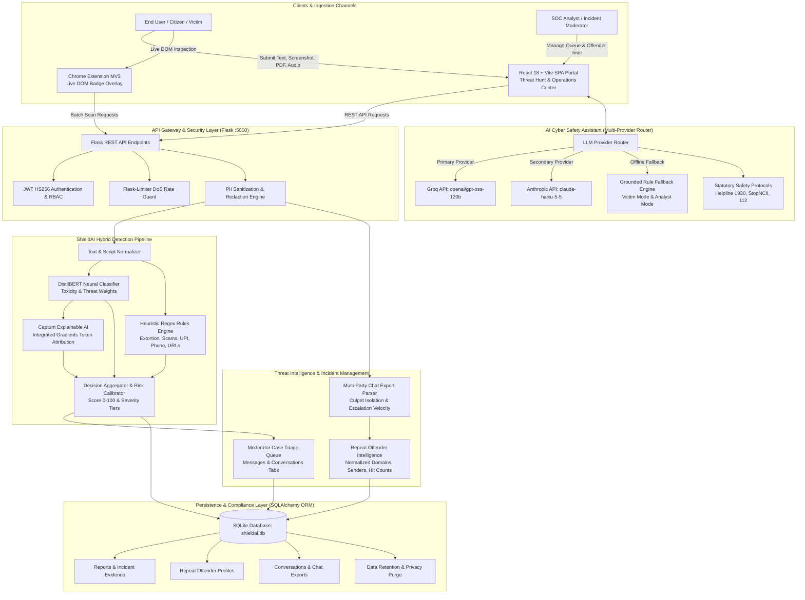

# ShieldAI - Cyber Threat Intelligence & Online Harassment Detection Platform

> **MCA Final-Year Capstone Project | Master of Computer Applications**  
> **Student:** Jayanth C  
> **Platform:** Production-Grade Neurosymbolic Cyber Safety & Incident Response Intelligence System  
> **Status:** Fully Tested & Operational — **118 Automated Tests Passing (100%)** | Clean Frontend Build

[](https://www.python.org/)
[](https://react.dev/)
[](https://vitejs.dev/)
[](https://flask.palletsprojects.com/)
[](https://pytorch.org/)
[](https://huggingface.co/)
[](https://captum.ai/)
[](https://www.sqlalchemy.org/)
[]()

---

## ⚡ Quick Start: How to Run Frontend & Backend

### Prerequisites
- **Python 3.10+** installed and available in PATH.
- **Node.js (v18+ or v20+)** and **npm** installed.
- (Optional) **Google Chrome** or Chromium-based browser for testing the Manifest v3 browser extension.

---

### Method 1: One-Click Startup (Recommended)

#### On Windows:
Double-click `start.bat` or run in PowerShell / Command Prompt:
```cmd
start.bat
```
*Or via PowerShell:*
```powershell
.\start.ps1
```

This single command will:
1. Launch the **Flask Backend API Server** on `http://127.0.0.1:5000`.
2. Launch the **React / Vite Frontend Server** on `http://localhost:5173`.
3. Open your browser directly to the ShieldAI platform.

#### On Linux / macOS:
```bash
chmod +x start.sh && ./start.sh
```

---

### Method 2: Manual Terminal Launch (Step-by-Step)

If you prefer launching each service in its own terminal window:

#### Terminal 1 — Backend API Server (Port 5000):
```bash
# 1. Navigate to the project root
cd online-harassment-detection

# 2. Activate Python virtual environment
# Windows:
.\venv\Scripts\activate
# Linux/macOS:
source venv/bin/activate

# 3. (First time only) Install backend dependencies
pip install -r backend/requirements.txt

# 4. Start the Flask application
python backend/app.py
```
> The backend will initialize the database (`backend/data/shieldai.db`), load model weights, and listen on **`http://127.0.0.1:5000`**.

#### Terminal 2 — Frontend React Application (Port 5173):
```bash
# 1. Navigate to the frontend directory
cd online-harassment-detection/frontend

# 2. (First time only) Install node packages
npm install

# 3. Start the Vite development server
npm run dev
```
> The frontend will compile and start on **`http://localhost:5173`**.

---

### Default Credentials & Access Portals

| Portal | URL | Credentials / Access |
| :--- | :--- | :--- |
| **ShieldAI Web Portal** | [http://localhost:5173](http://localhost:5173) | Public Threat Scanner & AI Safety Chat |
| **Admin Operations Center (SOC)** | [http://localhost:5173/#login](http://localhost:5173/#login) | Username: `admin`<br/>Password: `password123` |
| **One-Click Guest Session** | [http://localhost:5173/#login](http://localhost:5173/#login) | Click **"Initialize Guest Session &rarr;"** (auto-authenticates) |
| **Backend API Health Check** | [http://127.0.0.1:5000/api/health](http://127.0.0.1:5000/api/health) | Returns JSON status, provider info, and uptime |

---

### Installing the Chrome Manifest v3 Extension

1. Open Google Chrome and go to `chrome://extensions/`.
2. Enable **Developer mode** using the toggle switch in the top-right corner.
3. Click the **Load unpacked** button in the top-left corner.
4. Select the `extension/` folder inside this repository:
   ```
   online-harassment-detection/extension
   ```
5. *(Optional for local testing)* Click **Details** on the ShieldAI card, scroll down, and switch **"Allow access to file URLs"** to **ON**.
6. Open [`extension/test.html`](file:///c:/Users/jayanth/Downloads/online-harassment-detection/extension/test.html) or [http://localhost:5173/test.html](http://localhost:5173/test.html) to verify live badge rendering on risky content.

---

## 🏗️ System Architecture

ShieldAI implements a **Neurosymbolic Hybrid Architecture** combining fine-tuned transformer classification (`DistilBERT`), deterministic heuristic pattern engines, Explainable AI (`Captum`), a multi-provider crisis assistant, and an enterprise Security Operations Center (SOC).



---

## 🎯 Key Capabilities & Platform Modules

### 1. Multi-Modal Threat Hunt & Scan
- **Plain Text Analysis:** Sub-100ms classification across Cyberbullying, Harassment, Hate Speech, Physical Threats, Phishing, Financial Scams, and Suspicious Links.
- **Explainable AI (Captum XAI):** Visual token attribution highlighting the exact words and phrases that drove the threat score using Integrated Gradients.
- **Document & Evidence Extraction:** Upload and extract text from PDFs (`pypdf`/`pdfplumber`), images/screenshots (`RapidOCR`), and voice notes (`faster-whisper`).
- **Fail-Closed Multilingual Safety:** Romanized Hinglish and Kannada slang are natively evaluated. Native non-Latin scripts (Devanagari, Kannada, Tamil, Arabic) are flagged as `UNVERIFIED / UNSUPPORTED` rather than giving false "Safe" passes.

### 2. Multi-Party Chat Export Analysis (WhatsApp / Telegram)
- **Culprit Isolation:** Parses multi-sender dialogues (e.g., Raj, Priya, Sam) and isolates the specific perpetrator, preventing innocent group members from being flagged.
- **Escalation Velocity:** Calculates conversational acceleration over time, boosting risk scores if threats escalate across multiple messages.
- **Repeat Offender Linking:** Flagged senders are automatically cross-referenced with the repeat offender database.

### 3. Security Operations Center (SOC) & Report Queue
- **Dual Queue Tabs:** Separate views for individual **Messages** and multi-message **Conversations**.
- **Reload State Persistence:** Pressing `Ctrl+R` on Report Queue preserves your active tab and sub-tab (`Messages` vs `Conversations`) without redirecting to Threat Scan.
- **Interactive Triage:** Update incident statuses (`open`, `reviewing`, `resolved`, `dismissed`) with full audit logging.
- **Visual Analytics:** Real-time Recharts bar and area charts tracking threat category distribution and chronological trends.

### 4. Repeat Offender Intelligence & Domain Normalization
- **Entity Normalization:** Automatically strips schemes (`http://`, `https://`), `www.`, and trailing slashes so `http://sbi-kyc-update.xyz` and `sbi-kyc-update.xyz` are tracked as a single unified entity.
- **Actor Categories:** Profiles repeat offenders across Senders, URLs, Phone Numbers, and Email Addresses with cumulative hit counts, peak risk scores, and dated timeline logs.

### 5. AI Cyber Safety Assistant (Multi-Provider LLM Router)
- **Multi-Provider Architecture:** Integrates **Groq** (`openai/gpt-oss-120b`), **Anthropic** (`claude-haiku-5-5`), and an **Offline Grounded Rule Engine**.
- **Active Failover:** If cloud APIs run out of quota, time out, or throw 429 rate limits, the chatbot seamlessly falls back to offline deterministic rules with an transparent engine badge (`Groq`, `Claude`, or `Rules`).
- **Victim Support Mode:** Trauma-informed counseling: opens with empathy, provides a clear non-payment warning (*"Do not pay"*), at most 6 concrete evidence preservation steps, and official helplines (**1930, StopNCII.org, 112**).
- **Security Analyst Mode:** Technical IOC extraction, MITRE-style threat actor analysis, and Indian IT Act legal playbooks.

### 6. Privacy, PII Sanitization & Data Retention Purge
- **Automatic PII Redaction:** Masks phone numbers, emails, Aadhaar IDs, and PAN cards before database storage or external LLM transmission.
- **Private Scan Mode:** Users can opt out of database storage by ticking "Private Scan", running analysis strictly in-memory.
- **Compliance Purge:** Configurable statutory data retention (`DATA_RETENTION_DAYS`) with an on-demand administrator purge button complying with the DPDP Act.

---

## 📊 Calibrated Decision Thresholds & Benchmark Metrics

Sigmoid probabilities from the fine-tuned DistilBERT multi-label classifier are mapped to operational risk scores using calibrated decision thresholds ($\tau$):

| Category | Calibrated Threshold ($\tau$) | Operational Focus |
| :--- | :---: | :--- |
| **Hate Speech** | `0.8076` | Identity slurs, targeted discrimination, dehumanizing rhetoric |
| **Cyberbullying / Harassment** | `0.8905` | Sustained targeted abuse, derogatory attacks, stalking |
| **Physical Threat** | `0.5332` | Bodily harm, death threats, extortion demands |
| **Toxicity / Offensive Language** | `0.4210` | Hostile insults, profane remarks, general hostility |
| **Profanity** | `0.9966` | Explicit vulgarity and isolated obscene lexicon |
| **Clean / Benign** | `0.6906` | Civil, constructive dialogue and professional correspondence |

### Empirical Performance Comparison
Evaluated on the benchmark dataset split (Davidson et al., ~25,000 annotated records):
- **TF-IDF + Logistic Regression Baseline:** ~89.1% Accuracy | 0.81 Macro F1
- **Fine-Tuned DistilBERT Transformer:** **94.3% Accuracy | 0.93 Macro F1**

---

## 🧪 Automated Testing & Quality Verification

ShieldAI maintains a rigorous automated test suite covering authentication, RBAC, model inference, chat export parsing, multilingual invariants, and security:

```powershell
# Run the complete test suite
venv\Scripts\python.exe -m pytest -q
```

### Test Suite Summary:
```
============================== test session starts ==============================
118 passed, 1 skipped in ~55s (100% Pass Rate)
==================================================================================
```

### Frontend Production Build Verification:
```bash
cd frontend
npm run build
```
```
✓ 2404 modules transformed.
dist/index.html                              1.25 kB │ gzip:   0.65 kB
dist/assets/index-C9x5g1uj.css              77.45 kB │ gzip:  12.11 kB
dist/assets/AdvancedAnalytics-BVVdWCov.js  147.72 kB │ gzip:  51.67 kB
dist/assets/index-BN9TxM5C.js              909.05 kB │ gzip: 254.47 kB
✓ built in 44.50s (0 errors)
```

---

## 🆘 Official Statutory Crisis Helplines

ShieldAI includes hardcoded, zero-latency safety guardrails for immediate physical danger and mental health crises:

| Service / Authority | Helpline Number | Availability | Official Jurisdiction / Purpose | Official URL |
| :--- | :---: | :---: | :--- | :--- |
| **National Emergency Support (ERSS)** | `112` | 24/7 | Immediate physical safety, police, ambulance | [112.gov.in](https://112.gov.in/) |
| **National Cybercrime Helpline** | `1930` | 24/7 | Financial cyber fraud, account freeze, extortion | [cybercrime.gov.in](https://cybercrime.gov.in/) |
| **National Cybercrime Portal** | Web Filing | 24/7 | Formal cyber harassment, blackmail, stalking FIR | [cybercrime.gov.in](https://cybercrime.gov.in/) |
| **StopNCII.org** | Web Service | 24/7 | Non-consensual intimate image hash prevention | [stopncii.org](https://stopncii.org/) |
| **Tele-MANAS Mental Health** | `14416` / `1800-891-4416` | 24/7 | Free national mental health & distress counseling | [telemanas.mohfw.gov.in](https://telemanas.mohfw.gov.in/) |
| **KIRAN Helpline** | `1800-599-0019` | 24/7 | Department of Empowerment of Persons with Disabilities | [disabilityaffairs.gov.in](https://disabilityaffairs.gov.in/) |

---

## 📁 Repository Structure

```
online-harassment-detection/
├── backend/
│   ├── api/                   # REST API route blueprints (public, admin, auth, complaints)
│   ├── core/                  # Database (SQLAlchemy), config, exceptions, security
│   ├── data/                  # Persistent SQLite DB (shieldai.db) & benchmark datasets
│   ├── ml/                    # Neurosymbolic detection engine & models
│   │   ├── chatbot.py         # Multi-provider LLM router (Groq / Claude / Rules)
│   │   ├── explain_transformer.py # Captum Integrated Gradients token attribution
│   │   ├── train_baseline.py  # TF-IDF + Logistic Regression baseline
│   │   └── train_transformer.py # DistilBERT fine-tuning script
│   ├── services/              # PredictionService, ModelService, AdminService, Parsers
│   ├── tests/                 # 118 automated pytest test cases
│   ├── app.py                 # Flask server entrypoint (port 5000)
│   └── requirements.txt       # Python dependencies
├── frontend/
│   ├── src/
│   │   ├── components/        # React UI components (Dashboard, Chat, Scan, Queue)
│   │   ├── hooks/             # Custom hooks (useAuth, useAdminData)
│   │   ├── App.jsx            # Master router with reload hash/storage sync
│   │   └── main.jsx           # React DOM root
│   ├── index.html             # HTML5 template
│   ├── package.json           # Frontend dependencies (React, Vite, Tailwind, Recharts)
│   └── vite.config.js         # Vite configuration & backend proxy
├── extension/                 # Chrome Manifest v3 Browser Extension
│   ├── manifest.json          # Manifest v3 definition
│   ├── content.js             # Generic DOM scanner, MutationObserver
│   ├── popup.html / popup.js  # Settings UI (Safe badges, per-site toggle)
│   ├── test.html              # Social media feed test page
│   └── test_generic.html      # Generic paragraph test page
├── docs/                      # Architectural documentation & diagrams
│   └── diagrams/              # Modernized Mermaid (.mmd) & PNG diagrams
├── start.bat                  # One-click Windows CMD startup script
├── start.ps1                  # One-click Windows PowerShell startup script
├── start.sh                   # One-click Linux / macOS startup script
├── VIVA_DEFENSE_AND_ARCHITECTURE_GUIDE.md # Master academic viva defense guide
└── README.md                  # Project documentation
```

---

## 🎓 Academic Viva Defense Reference
For complete preparation for external and internal viva examinations—including tech stack comparisons, examiner trap questions, and the full architectural defense—refer to:
👉 **[`VIVA_DEFENSE_AND_ARCHITECTURE_GUIDE.md`](./VIVA_DEFENSE_AND_ARCHITECTURE_GUIDE.md)**
